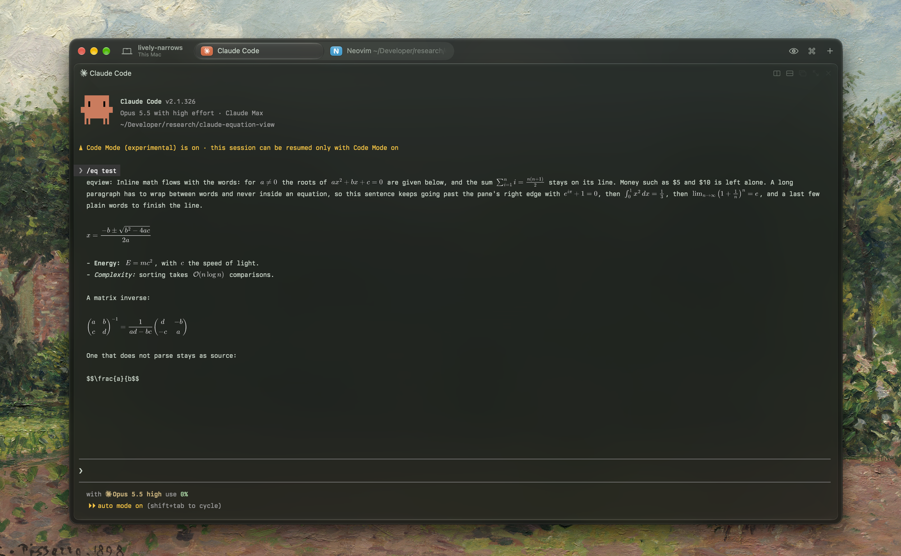

# Claude Equation View

Draws the LaTeX equations in Claude Code's replies, display and inline, as
images inside the transcript, through the kitty graphics protocol. Built for Claude Code running in
the Rex terminal.



## Run it

```sh
cd daemon && bun install        # once
CLAUDE_CODE_FORCE_TERMINAL_IMAGES=1 claude --plugin-dir /path/to/claude-equation-view/mod
```

The environment variable is needed because Rex is not on Claude Code's built-in
list of terminals that draw images.

In the session:

| Command | What it does |
| :- | :- |
| `/eq test` | Draws three sample equations without calling the model |
| `/eq status` | Shows whether the renderer runs and the measured cell size |
| `/eq off`, `/eq on` | Shows the LaTeX source, or the images again |
| `/eq inline off`, `/eq inline on` | Leaves inline math as source, or draws it |
| `/eq baseline -0.05` | Moves inline math up (negative) or down, as a share of the row height |
| `/eq color #rrggbb` | Sets the equation color |
| `/eq scale 1.2` | Sets the math size relative to the terminal font |
| `/eq measure` | Asks Rex for the cell size again |

`Ctrl+O` always shows a reply's original text.

## How it works

- `mod/` is a Claude Code mod. Its render hook on assistant messages splits the
  markdown into prose and display math (`$$…$$`, `\[…\]`, `equation`, `align`
  and similar environments), and returns `Image` elements for the math.
- Inline math (`$…$`, `\(…\)`) is drawn as a one-row image on the text's
  baseline. A `Markdown` element cannot hold an image, so the mod lays out any
  paragraph, heading or list that has inline math itself, word by word, in a
  wrapping row. Blocks without inline math are left to Claude Code.
- `daemon/` is a Bun process the mod starts with the session. It keeps MathJax
  loaded, turns TeX into SVG and then into a PNG with resvg, and answers over a
  Unix socket in `~/.cache/eqview/run/`.
- Each PNG is exactly a whole number of terminal cells, using the cell size Rex
  reports for the pane, so the terminal draws it without resampling.

An equation that does not parse, or is not closed yet while the reply streams,
stays as source. So does inline math inside a table or a block quote. `$5`,
`$HOME` and anything in code are never read as math.

## Tests

```sh
cd daemon && bun test
claude plugin validate mod
```
